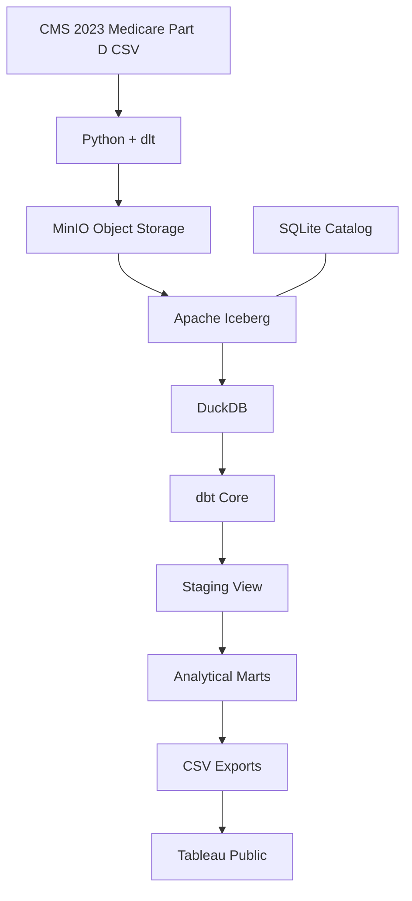

# MedIntel — Medicare Prescription Cost Intelligence

**Turning 26.8 million prescription records into healthcare cost insights.**

An end-to-end healthcare analytics lakehouse built with Python, dlt, MinIO, Apache Iceberg, DuckDB, dbt Core, and Tableau Public.

[](https://public.tableau.com/app/profile/abinaya.n5599/viz/MedicarePartDAnalyticsPrescriptionCostGenericOptimization2023/MedicarePartDAnalytics)

## Live dashboard

**[Explore the interactive MedIntel dashboard on Tableau Public →](https://public.tableau.com/app/profile/abinaya.n5599/viz/MedicarePartDAnalyticsPrescriptionCostGenericOptimization2023/MedicarePartDAnalytics)**

Four analytical views:

1. **Brand vs Generic Cost** — compares aggregate reported drug costs across the two name-based classifications.
2. **Top 10 Drug Costs** — highlights drug names with the highest reported prescription costs.
3. **Provider Analysis** — explores reported costs across provider states and specialties.
4. **Generic Cost Optimization Opportunities** — ranks scenario-based generic cost comparisons.

## Project overview

MedIntel analyzes the **2023 CMS Medicare Part D Prescribers by Provider and Drug** dataset to explore prescription utilization, reported drug costs, brand-versus-generic patterns, and potential cost-optimization scenarios.

The pipeline ingests the source CSV in batches, stores it in an Iceberg table on S3-compatible object storage, transforms it with SQL and dbt, and exports analytical marts for Tableau Public.

## Business questions

- How do reported costs differ between records classified as brand and generic?
- Which generic drug names are associated with the highest reported costs?
- How do prescription costs vary across provider states and specialties?
- Which drug names show a lower generic cost per claim than brand cost per claim?
- What does a simple cost-difference scenario look like if brand claims were priced at the observed generic cost per claim?

## Architecture



### Technology stack

| Layer | Technology | Role |
|---|---|---|
| Source | CMS Medicare Part D CSV (2023) | Provider-and-drug prescription data |
| Ingestion | Python, dlt | Batch ingestion |
| Object storage | MinIO | S3-compatible storage |
| Table format | Apache Iceberg, PyIceberg | Table metadata and snapshots |
| Catalog | SQLite | Local catalog metadata |
| Query engine | DuckDB | Analytical SQL |
| Transformation | dbt Core | Staging and marts |
| Visualization | Tableau Public | Interactive dashboard |
| Runtime | Docker Engine, Docker Compose, Ubuntu on WSL2 | Local infrastructure |

## Dataset profile

| Attribute | Measured value |
|---|---:|
| Source records | 26,794,878 |
| Source columns | 22 |
| Extracted CSV size | Approximately 3.61 GB |
| ZIP archive size | Approximately 657.84 MB |
| Distinct generic drug names | 1,779 |
| Brand and generic names equal (case-insensitive) | 18,428,364 (68.78%) |
| Brand and generic names different | 8,366,514 (31.22%) |
| Invalid numeric values found during profiling | 0 across 10 inspected numeric columns |

The source includes provider identifiers and attributes, drug brand and generic names, claims, fills, days supplied, reported drug costs, and beneficiary-related fields.

## Pipeline implementation

### 1. Ingestion and storage

- Processed the source CSV in batches of 25,000 records using Python and dlt.
- Wrote the production dataset to MinIO through its S3-compatible interface.
- Stored the data in Apache Iceberg format and verified the latest Iceberg snapshot.

### 2. Querying and transformation

- Queried the Iceberg dataset with DuckDB.
- Used dbt Core to create a staging view and three analytical marts.
- Applied safe numeric casting and aggregate SQL calculations.
- Exported the mart results as CSV files for Tableau.

### 3. Analytical models

| Model | Purpose |
|---|---|
| `stg_prescriber_drug` | Standardized staging view |
| `mart_drug_cost_analysis` | Brand/generic cost and utilization comparison |
| `mart_provider_analysis` | State and provider-specialty analysis |
| `mart_generic_opportunities` | Scenario-based generic cost comparison |

## Production metrics

| Metric | Measured result |
|---|---:|
| Records ingested | 26,794,878 |
| Ingestion batches | 1,072 |
| Ingestion duration | 129.37 minutes |
| Average ingestion throughput | Approximately 3,452 records/second |
| Iceberg data files | 1,072 Parquet files |
| MinIO objects | 5,366 |
| Total MinIO object size | Approximately 1.374 GB |
| dbt staging data tests passed | 4 |
| Analytical marts created | 3 |

These are measured results from the completed local production run.

## Data quality and interpretation

- Suppressed or missing beneficiary values are retained as `NULL`, not converted to zero.
- Numeric fields are handled using safe casts.
- Four staging checks validate non-null provider NPI, brand name, generic name, and total claims.
- Brand/generic classification is based on case-insensitive equality between the source brand name and generic name.
- The source is aggregated at provider-drug level, not individual patient transaction level.
- The detailed source file excludes provider-drug combinations with fewer than 11 claims because of CMS suppression rules.
- Matching generic names do **not** prove clinical interchangeability. This analysis does not establish equivalence by strength, dosage form, or route.
- Reported total drug cost should not be interpreted as Medicare-only payment or as an amount that can necessarily be saved.
- The generic opportunity metric is a **scenario estimate**: the positive difference between brand and generic cost per claim multiplied by brand claims. It is not actual realized savings, a causal estimate, or a recommendation to substitute medication.
- Results are exploratory aggregate comparisons and can be affected by differences in provider mix, drug characteristics, and claim volume.

## Reproducing the project

The public repository contains code, model definitions, exported mart CSVs, metrics, and documentation. Raw CMS data, local MinIO objects, credentials, local catalog state, and the DuckDB database are not committed.

A full local reproduction requires obtaining the 2023 CMS source file, starting MinIO with Docker Compose, configuring local S3/catalog credentials, running the ingestion script, setting `MEDICARE_ICEBERG_METADATA_PATH` to the resulting Iceberg metadata JSON, configuring the dbt profile, running dbt, and exporting the marts.

Storage credentials, endpoints, catalog configuration, and dbt profiles are environment-specific; do not commit secrets.

`requirements.txt` installs ingestion dependencies. `requirements-analytics.txt` contains the DuckDB/dbt analytics environment dependencies. Separate virtual environments may be used.

## Repository structure

```text
medintel/
├── dashboard/data/           # Exported analytical mart CSVs
├── dbt/medicare_analytics/   # dbt models and mart export script
├── docs/                     # Architecture documentation
├── metrics/                  # Measured project metrics
├── reports/                  # Dataset quality profile
├── src/                      # Ingestion and analysis scripts
├── requirements.txt
├── requirements-ingestion.txt
├── requirements-analytics.txt
└── README.md
```

Raw source data, local state, credentials, and runtime databases are intentionally excluded from the public repository.

## Future improvements

- Add automated data-quality checks for each analytical mart.
- Improve brand/generic classification using drug-level attributes such as strength and dosage form.
- Add sample-size thresholds and uncertainty indicators to cost comparisons.
- Automate ingestion, transformation, and dashboard refresh workflows.

## Disclaimer

This project is for educational and analytical purposes. It is not medical advice, clinical substitution guidance, or verification of financial savings.

## Author

**Abinaya N.**

Healthcare Data Analytics · Data Engineering · SQL · Python · Tableau
