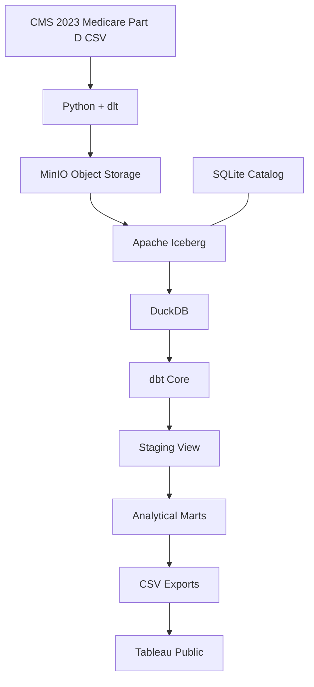

# MedIntel — Medicare Prescription Cost Intelligence

**Turning 26.8 million prescription records into healthcare cost insights.**

An end-to-end healthcare analytics lakehouse built using Python, dlt, MinIO, Apache Iceberg, DuckDB, dbt Core, and Tableau Public.

[](https://public.tableau.com/app/profile/abinaya.n5599/viz/MedicarePartDAnalyticsPrescriptionCostGenericOptimization2023/MedicarePartDAnalytics)

## Live Dashboard

**[Explore the interactive MedIntel dashboard on Tableau Public](https://public.tableau.com/app/profile/abinaya.n5599/viz/MedicarePartDAnalyticsPrescriptionCostGenericOptimization2023/MedicarePartDAnalytics)**

The dashboard contains four analytical views:

1. Brand vs Generic Cost
2. Top 10 Drug Costs
3. Provider Analysis
4. Generic Cost Optimization Opportunities

## Project Overview

MedIntel analyzes the 2023 CMS Medicare Part D Prescribers by Provider and Drug dataset.

The project explores prescription utilization, reported drug costs, provider-level patterns, and brand-versus-generic cost comparisons.

The pipeline processes the source CSV in batches, stores the data in an Apache Iceberg table on MinIO, transforms it using DuckDB and dbt, and exports analytical marts for Tableau Public.

## Business Questions

- How do reported prescription costs differ between brand-classified and generic-classified records?
- Which drug names have the highest reported prescription costs?
- How do prescription costs vary across provider states and specialties?
- Which drug names have lower generic-classified cost per claim than brand-classified cost per claim?
- What would a simplified cost-difference scenario look like if brand claims were priced at the observed generic cost per claim?

## Architecture



## Technology Stack

| Layer | Technology | Purpose |
|---|---|---|
| Source | CMS Medicare Part D CSV | Prescription provider-drug data |
| Ingestion | Python, dlt | Batch ingestion |
| Object storage | MinIO | S3-compatible object storage |
| Table format | Apache Iceberg, PyIceberg | Table metadata and snapshots |
| Catalog | SQLite | Local catalog metadata |
| Query engine | DuckDB | Analytical SQL |
| Transformation | dbt Core | Staging and analytical marts |
| Visualization | Tableau Public | Interactive dashboards |
| Infrastructure | Docker Engine, Docker Compose, WSL2 | Local runtime |

## Dataset Profile

| Attribute | Measured value |
|---|---:|
| Source records | 26,794,878 |
| Source columns | 22 |
| Extracted CSV size | Approximately 3.61 GB |
| Source ZIP size | Approximately 657.84 MB |
| Distinct generic drug names | 1,779 |
| Brand and generic names equal | 18,428,364 (68.78%) |
| Brand and generic names different | 8,366,514 (31.22%) |
| Invalid numeric values | 0 across 10 inspected numeric columns |

The dataset contains provider identifiers and attributes, brand and generic drug names, claims, fills, days supplied, reported drug costs, and beneficiary-related fields.

## Pipeline Implementation

### 1. Data Ingestion

- Processed the source CSV in batches of 25,000 records using Python and dlt.
- Loaded the data into MinIO using its S3-compatible interface.
- Stored the dataset in Apache Iceberg format.
- Verified the production Iceberg snapshot and ingested record count.

### 2. Querying and Transformation

- Queried the Iceberg dataset using DuckDB.
- Created a staging view using dbt Core.
- Built three analytical data marts.
- Used safe numeric casting and SQL aggregations.
- Exported analytical marts to CSV for Tableau.

### 3. Analytical Models

| Model | Purpose |
|---|---|
| `stg_prescriber_drug` | Standardizes source data |
| `mart_drug_cost_analysis` | Compares reported drug costs and utilization |
| `mart_provider_analysis` | Analyzes provider state and specialty patterns |
| `mart_generic_opportunities` | Performs threshold-filtered cost comparison scenarios |

## Production Metrics

| Metric | Measured result |
|---|---:|
| Records ingested | 26,794,878 |
| Ingestion batches | 1,072 |
| Ingestion duration | 129.37 minutes |
| Average throughput | Approximately 3,452 records/second |
| Iceberg Parquet data files | 1,072 |
| MinIO objects | 5,366 |
| Total MinIO object size | Approximately 1.374 GB |
| dbt staging tests passed | 4 |
| Analytical marts created | 3 |

These metrics represent the completed local production ingestion and transformation run.

## Analytical Methodology

### Brand and Generic Classification

A source record is classified as generic when its brand name and generic name match after trimming whitespace and ignoring case.

Otherwise, the record is classified as brand.

This is a name-based analytical classification, not a clinical equivalence determination.

### Cost Comparison

For each generic drug name, the model calculates:

- Total brand-classified claims.
- Total generic-classified claims.
- Total reported costs for both classifications.
- Reported cost per claim for both classifications.

### Scenario-Based Cost Optimization

The generic opportunity model requires at least 1,000 claims in each classification.

It calculates:

`Estimated difference per claim = MAX(Brand cost per claim - Generic cost per claim, 0)`

`Scenario estimate = Estimated difference per claim × Brand claims`

The 1,000-claim threshold is an analyst-defined screening rule. It is not a statistical significance threshold.

The scenario estimate is not actual savings, a causal estimate, or a recommendation to substitute medication.

## Data Quality and Limitations

- Missing and suppressed beneficiary values are retained as NULL rather than converted to zero.
- Numeric fields are handled using safe casts.
- Four staging tests validate non-null provider NPI, brand name, generic name, and total claims.
- The source is aggregated at provider-drug level, not individual patient transaction level.
- The detailed CMS file excludes provider-drug combinations with fewer than 11 claims because of CMS suppression rules.
- Matching names do not prove clinical interchangeability. Strength, dosage form, and route are not established by this analysis.
- Reported total drug cost must not be interpreted as Medicare-only payment or guaranteed savings.
- Cost differences can be influenced by drug characteristics, provider mix, and other factors.

The project is intended for exploratory healthcare analytics, not clinical or financial decision-making.

## Reproducing the Project

The public repository includes ingestion scripts, transformation models, documentation, measured metrics, and exported analytical CSVs.

A full local reproduction requires:

1. Obtaining the 2023 CMS source dataset.
2. Configuring MinIO and its S3 credentials.
3. Configuring the local SQLite catalog and Iceberg storage.
4. Running the Python/dlt ingestion pipeline.
5. Setting `MEDICARE_ICEBERG_METADATA_PATH` to the resulting Iceberg metadata JSON.
6. Configuring the local dbt profile for DuckDB and MinIO access.
7. Running dbt models and tests.
8. Exporting the analytical marts.
9. Connecting the exported CSVs to Tableau and refreshing the published workbook.

The ingestion and analytics environments are separated:

- `requirements-ingestion.txt` contains ingestion dependencies.
- `requirements-analytics.txt` contains DuckDB and dbt dependencies.

The root `requirements.txt` references the ingestion requirements.

Credentials, local profiles, raw data, local catalog state, and DuckDB databases are not committed.

## Repository Structure

```text
medintel/
├── dashboard/
│   └── data/
│       ├── mart_drug_cost_analysis.csv
│       ├── mart_generic_opportunities.csv
│       └── mart_provider_analysis.csv
├── dbt/
│   └── medicare_analytics/
│       ├── models/
│       │   ├── staging/
│       │   └── marts/
│       ├── export_marts.py
│       ├── dbt_project.yml
│       └── README.md
├── docs/
│   └── architecture.md
├── metrics/
│   └── project_metrics.csv
├── reports/
│   └── data_quality_profile.json
├── src/
│   ├── analysis/
│   └── ingestion/
├── requirements.txt
├── requirements-ingestion.txt
├── requirements-analytics.txt
└── README.md
```

## Future Improvements

- Automate ingestion and transformation workflows.
- Improve drug classification using strength and dosage-form attributes.
- Add more comprehensive mart-level data-quality checks.
- Introduce additional analytical dimensions and dashboard filters.

## Disclaimer

This project is for educational and analytical purposes. It is not medical advice, clinical substitution guidance, or verification of financial savings.

## Author

**Abinaya N.**

Healthcare Analytics | Data Engineering | SQL | Python | Tableau
