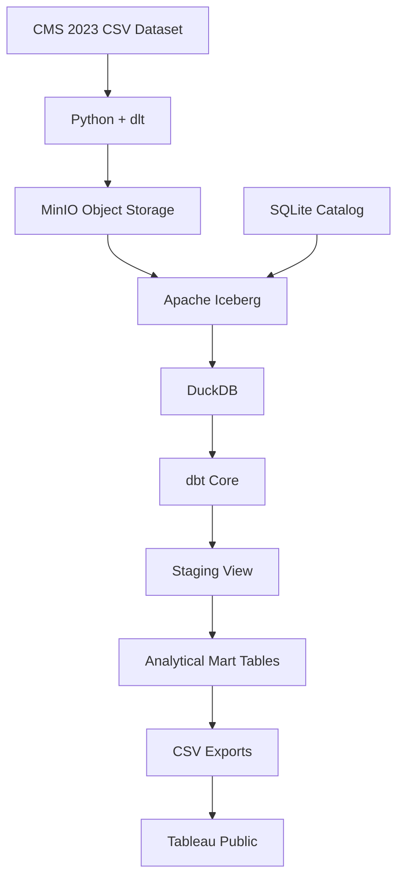

# Medicare Part D Lakehouse Architecture

## Architecture Overview

The project follows a lakehouse architecture that combines object storage, open table formats, analytical querying, SQL transformations, and business intelligence.

## Data Flow

1. **Source:** 2023 CMS Medicare Part D Prescribers by Provider and Drug CSV.
2. **Ingestion:** Python and dlt process the source in batches.
3. **Object Storage:** MinIO stores the ingested data.
4. **Table Format:** Apache Iceberg manages the production dataset.
5. **Catalog:** SQLite maintains local catalog metadata.
6. **Query Engine:** DuckDB queries the Iceberg table.
7. **Transformation:** dbt Core builds staging and analytical models.
8. **Visualization:** Tableau Public presents the aggregated analytical outputs.

## Architecture Diagram

## Analytical Models

- `stg_prescriber_drug`
- `mart_drug_cost_analysis`
- `mart_provider_analysis`
- `mart_generic_opportunities`

## Deployment Environment

- Windows 11
- Ubuntu on WSL2
- Docker Engine and Docker Compose
- Python 3.11.9
- DuckDB 2.0.1
- dbt Core 1.12.7
- MinIO S3-compatible object storage

## Design Considerations

The project uses local infrastructure and open-source technologies rather than paid cloud services. The production dataset is stored in MinIO as Iceberg data, while analytical models are materialized in DuckDB.
