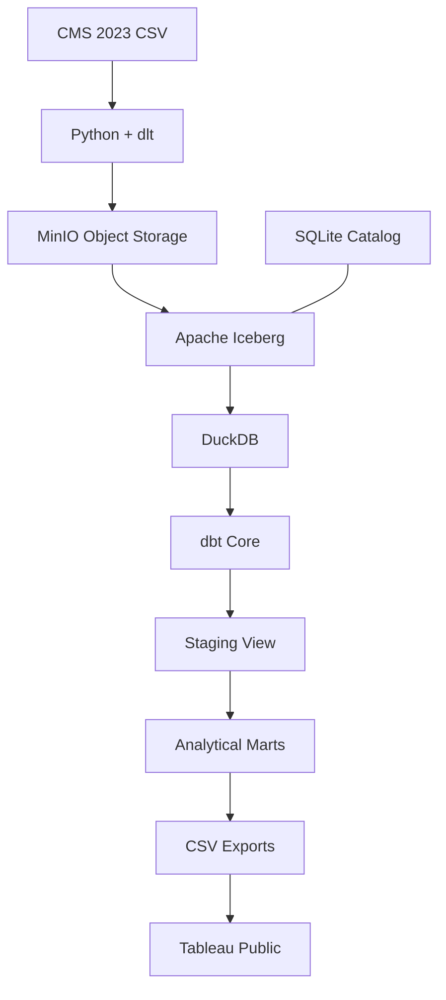

# MedIntel — Lakehouse Architecture

## Overview

MedIntel is a local end-to-end analytics lakehouse for the 2023 CMS Medicare Part D Prescribers by Provider and Drug dataset.

## Data flow

1. **Source:** CMS 2023 provider-and-drug CSV.
2. **Ingestion:** Python and dlt process the source in batches.
3. **Object storage:** MinIO stores the ingested objects.
4. **Table format:** Apache Iceberg manages the production table and snapshots.
5. **Catalog:** SQLite stores local catalog metadata.
6. **Query engine:** DuckDB queries the Iceberg table.
7. **Transformation:** dbt Core builds staging and analytical marts.
8. **Export:** Python exports mart tables to CSV.
9. **Visualization:** Tableau Public presents the analytical views.

## Architecture diagram

## Analytical models

- `stg_prescriber_drug`
- `mart_drug_cost_analysis`
- `mart_provider_analysis`
- `mart_generic_opportunities`

## Deployment environment

- Windows 11 with Ubuntu on WSL2
- Docker Engine and Docker Compose
- MinIO S3-compatible object storage
- Python 3.11.9 for ingestion
- DuckDB 2.0.1
- dbt Core 1.12.7 with dbt-duckdb 1.11.1

## Configuration note

The staging model reads its Iceberg metadata JSON path from `MEDICARE_ICEBERG_METADATA_PATH`. Set this environment variable to the metadata file for the table created by the local ingestion run.

Do not hardcode local credentials or machine-specific paths in the repository.

The S3 endpoint, credentials, catalog settings, and dbt profile are environment-specific and must be configured locally.
